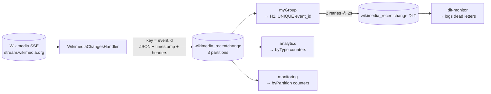

# kafka-lab

A two-module Spring Boot playground for Apache Kafka delivery mechanics, driven by the
**live Wikimedia `recentchange` SSE stream**: JSON on the wire, keyed partitioning, four
independent consumer groups, retry-then-DLT failure handling, and an idempotent consumer
backed by a UNIQUE column.


-c71a36)

## What it does

```
Wikimedia SSE → producer → wikimedia_recentchange (3 partitions)
                              ├── myGroup     → H2 database (idempotent)
                              ├── analytics   → counters per event type
                              ├── monitoring  → counters per partition
                              └── dlt-monitor → wikimedia_recentchange.DLT
```

| Module | Role |
|---|---|
| `kafka-producer-wikimedia` | Reads the SSE stream, parses each event into a `WikimediaEvent` record, publishes JSON keyed by the event id with explicit timestamp, headers and a send callback. |
| `kafka-consumer-database` | Four listener groups, error handler (2 retries @ 2s → DLT), idempotent write to H2. |

Every edge above traces to code: `WikimediaChangesHandler.onMessage()` →
`WikimediaChangesProducer` → `WikimediaTopicConfig` → `WikimediaEventListeners`
(`@KafkaListener` × 4) → `KafkaListenerConfig.errorHandler()`.

## Architecture



## Design decisions

- **Keyed by event id.** All records for one event land on the same partition, so keyed
  ordering survives parallelism; `monitoring()` prints the live partition split.
- **JSON without type headers.** `spring.json.add.type.headers=false` plus a fixed
  consumer-side `default.type` keeps class names off the wire — producers and consumers
  evolve independently (no Schema Registry running here).
- **`ErrorHandlingDeserializer` wrapper.** A record that fails deserialization becomes a
  handled error instead of killing the listener container, so poison messages reach the DLT too.
- **Bounded retries, then DLT.** `FixedBackOff(2000L, 2L)` = 3 delivery attempts 2s apart,
  then `DeadLetterPublishingRecoverer` publishes to `.DLT` (the resolver is explicit because
  the default would name it `wikimedia_recentchange-dlt`).
- **Idempotent consumer.** `event_id` is UNIQUE in the database; `existsByEventId()` skips
  redelivered records, and the constraint is what actually guarantees "stored once".
- **`meta.id` fallback.** `log` events carry no top-level `id` (≈2% of the stream), so the
  record's compact constructor falls back to `meta.id` and then drops `meta` before the value
  is serialized. Without it those records violate `event_id NOT NULL` and end up in the DLT.

## Tech stack

| Component | Version | Role |
|---|---|---|
| Java | 17 | Runtime |
| Spring Boot | 4.1.1 | Application framework |
| spring-kafka | 4.1.1 | Producer & consumer |
| okhttp-eventsource | 5.0.0 | SSE client (background, reconnecting) |
| H2 | 2.4.240 | Database (`jdbc:h2:file:...`) |
| Maven | wrapper included | Build |

## Getting started

**Prerequisites:** JDK 17+, a Kafka broker on `localhost:9092`, outbound HTTPS to
`stream.wikimedia.org`. Topics (`wikimedia_recentchange`, `wikimedia_recentchange.DLT`,
3 partitions each) are created automatically at startup.

```bash
./mvnw clean package
```

Run the consumer first (it also declares the topics), then the producer:

```bash
java -jar kafka-consumer-database/target/kafka-consumer-database-0.0.1-SNAPSHOT.jar
java -jar kafka-producer-wikimedia/target/kafka-producer-wikimedia-0.0.1-SNAPSHOT.jar
```

Watch the console:

- `Published event: topic=..., partition=..., offset=...` — the producer callback (step 1).
- `partition=2, offset=9246, event=...` — consumer-side partition/offset headers (step 4).
- `analytics: total=..., byType={edit=...}` and `monitoring: ... byPartition={0=..., 1=..., 2=...}`
  — two independent groups reading the same topic (step 3).
- `Dead letter: ...` — a record that exhausted its retries (steps 5–6).

Trigger the failure path by publishing an event whose title contains `FAIL`; it is retried
three times and then routed to the DLT.

Run the tests (no live broker needed — the consumer test boots an embedded one):

```bash
./mvnw test
```

## Project structure

```
pom.xml                                 # parent: shared deps, Java 17, Boot 4.1.1
kafka-producer-wikimedia/
└── src/main/java/com/hassan/kafka/
    ├── WikimediaChangesProducer.java   # lifecycle: start/stop the SSE source
    ├── WikimediaChangesHandler.java    # SSE → JSON record: key, timestamp, headers, callback
    ├── WikimediaEvent.java             # wire record + meta.id fallback
    └── WikimediaTopicConfig.java       # NewTopic, 3 partitions
kafka-consumer-database/
└── src/main/java/com/hassan/kafka/
    ├── WikimediaEventListeners.java    # 4 groups: DB, analytics, monitoring, DLT
    ├── KafkaListenerConfig.java        # topics + DefaultErrorHandler + DLT recoverer
    ├── event/WikimediaEvent.java       # same wire contract, consumer side
    ├── entity/WikimediaEventEntity.java# UNIQUE event_id → idempotency
    └── repository/WikimediaDataRepository.java
```

## Tests

| Test | Module | Asserts |
|---|---|---|
| `WikimediaEventTest` | producer | SSE payload → record mapping (snake_case, numeric coercion, unknown fields) and the `meta.id` fallback. |
| `WikimediaPipelineTest` | consumer | `@EmbeddedKafka` with 3 partitions: redelivered events are stored exactly once, and a `FAIL` event is retried then dead-lettered (never stored). |

## What this practices

Partition strategy and ordering guarantees, consumer-group fan-out versus competing
consumers, at-least-once delivery and the idempotent consumer that has to accompany it,
bounded retries with a dead-letter topic, and JSON serialization without type headers.

## Next steps

- Schema registry (Avro/Protobuf) to replace the free-form JSON contract
- Move `WikimediaEvent` into a shared module instead of keeping two copies in sync
- Metrics via Micrometer (publish failures, DLT size, per-partition lag)
- A drain/replay tool for the DLT

## License

Not decided yet — add a `LICENSE` file before publishing.
